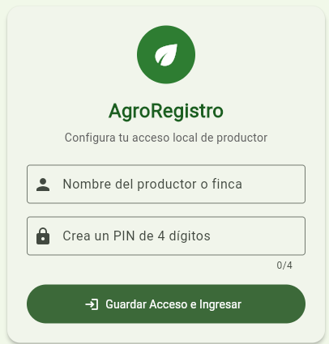
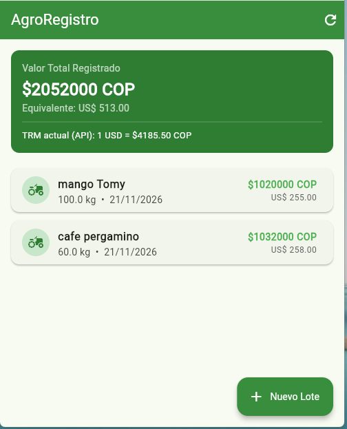
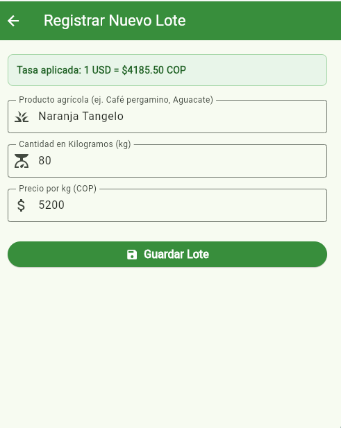
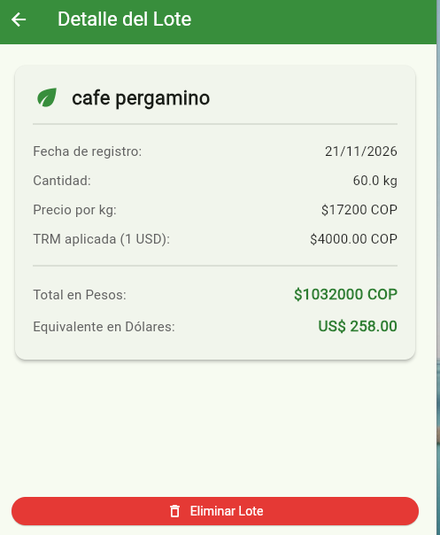

# 🌱 AgroRegistro — Gestión de Lotes Agrícolas y Conversión de Divisas (COP/USD)

Aplicación móvil y web desarrollada en **Flutter** para facilitar a pequeños productores y comerciantes agrícolas el registro de sus lotes de cosecha en pesos colombianos (COP), el cálculo del valor total acumulado de su inventario y la obtención automática de su equivalencia en dólares estadounidenses (USD) mediante el consumo de un endpoint REST en formato JSON.

---

## 1. Problema, Usuarios y Alcance

* **Problema:** Los pequeños agricultores y comerciantes locales suelen llevar el control de sus cosechas en cuadernos físicos, lo que dificulta conocer en tiempo real el valor consolidado de su inventario y su equivalencia frente al dólar (referencia clave para estimar costos de insumos y fertilizantes importados).
* **Usuarios objetivo:** Pequeños productores agrícolas, asociaciones campesinas y comerciantes de plazas de mercado.
* **Alcance funcional (Qué hace la app):**
  * Permite configurar un perfil local de productor protegido mediante un PIN numérico de 4 dígitos.
  * Registra lotes agrícolas con validación estricta de datos (nombre del producto, cantidad en kilogramos y precio por kg en COP).
  * Consulta mediante HTTP la tasa de cambio vigente USD → COP y calcula automáticamente el valor de cada lote y del inventario total en ambas monedas.
  * Almacena los registros localmente de forma persistente para conservar la información tras cerrar la aplicación.
  * Permite consultar el desglose detallado de cada lote y eliminar registros.
* **Fuera de alcance (Qué no hace):** No gestiona pasarelas de pago, facturación electrónica ni sincronización de cuentas en la nube.

---

## 2. Arquitectura y Estructura del Proyecto

El código fuente sigue una arquitectura modular organizada por separación de responsabilidades:

```text
lib/
├── main.dart                    # Punto de entrada, configuración Material 3 y pantalla inicial
├── models/
│   └── lote_model.dart          # Modelo LoteAgricola con serialización toJson / fromJson
├── services/
│   ├── api_service.dart         # Consumo HTTP de la tasa USD/COP con manejo de timeout y respaldo
│   └── storage_service.dart     # Persistencia local de datos mediante SharedPreferences + JSON
├── screens/
│   ├── login_screen.dart        # Pantalla 1: Acceso local con perfil y PIN de 4 dígitos
│   ├── home_screen.dart         # Pantalla 2: Resumen financiero, estado de TRM y lista de lotes
│   ├── add_lote_screen.dart     # Pantalla 3: Formulario validado para registrar nuevos lotes
│   └── detail_screen.dart       # Pantalla 4: Detalle completo del lote y opción de eliminación
└── widgets/
    └── lote_card.dart           # Componente visual reutilizable para renderizar cada lote
```

---

## 3. Pantallas y Flujo de Navegación

La aplicación implementa **4 pantallas principales conectadas mediante navegación imperativa (`Navigator.pushReplacement`, `Navigator.push` y `Navigator.pop`)**:

1. **Acceso Local (`LoginScreen`):** Permite al productor configurar su nombre y PIN de 4 dígitos en el primer ingreso (almacenados localmente mediante `shared_preferences` sin credenciales quemadas en el código) y valida el acceso en sesiones posteriores navegando hacia el inicio con `Navigator.pushReplacement`.
2. **Inicio (`HomeScreen`):** Muestra la tarjeta resumen con el valor total del inventario en COP y USD, la tasa de cambio aplicada y el listado dinámico de lotes (`ListView.builder`). Incluye botón de actualización manual y botón flotante para agregar registros.
3. **Nuevo Lote (`AddLoteScreen`):** Recibe como argumento la tasa USD actual, valida todos los campos mediante `GlobalKey<FormState>` y retorna el nuevo objeto `LoteAgricola` a la pantalla principal con `Navigator.pop(context, nuevoLote)`.
4. **Detalle del Lote (`DetailScreen`):** Recibe el objeto `LoteAgricola` seleccionado al tocar una tarjeta, despliega todos sus atributos (fecha, peso, precio unitario, TRM aplicada y totales) y permite eliminarlo devolviendo confirmación (`Navigator.pop(context, true)`).

---

## 4. Capturas de Pantalla

| Acceso Local | Pantalla Principal | Registro de Lote | Detalle del Lote |
| :---: | :---: | :---: | :---: |
|  |  |  |  |

---

## 5. Consumo de API REST

* **Endpoint utilizado:** `https://githubusercontent.com`
* **Justificación:** Se implementó un endpoint REST público en formato JSON sin necesidad de API Key, evitando la exposición de credenciales sensibles en el repositorio y garantizando compatibilidad multiplataforma.
* **Manejo de estados y fallos:**
  * *Estado de carga:* Muestra un `CircularProgressIndicator` mientras se ejecuta la petición HTTP GET.
  * *Resiliencia offline:* Configura un límite de espera (`timeout` de 4 segundos) y captura excepciones de red o bloqueos de proxy/firewall, aplicando automáticamente una tasa de respaldo vigente (`$4,185.50 COP`) para que el agricultor pueda seguir trabajando sin interrupciones.

---

## 6. Persistencia Local de Datos

* **Estrategia elegida:** Serialización de objetos Dart a formato JSON almacenados localmente en el dispositivo mediante el paquete **`shared_preferences`** (tanto para los lotes agrícolas como para el perfil local del productor).
* **Justificación frente a alternativas:** Se evaluó `sqflite` (SQLite), pero se seleccionó `shared_preferences` + JSON porque el modelo consta de entidades estructuradas ligeras que no requieren consultas relacionales complejas, y garantiza **ejecución nativa uniforme en Android, iOS y Web** sin requerir binarios nativos adicionales.

---

## 7. Gestión de Estado y Paquetes Utilizados

* **Gestión de estado:** Estado local nativo de Flutter mediante `StatefulWidget` y `setState()`, logrando una arquitectura clara, predecible y alineada con los fundamentos del curso.
* **Dependencias principales (`pubspec.yaml`):**
  * `http: ^1.2.2` — Ejecución de peticiones HTTP GET para obtener la tasa de cambio.
  * `shared_preferences: ^2.5.6` — Almacenamiento persistente clave-valor en el dispositivo.

---

## 8. Privacidad y Seguridad

* **Cero credenciales expuestas:** El código fuente no contiene claves privadas, tokens ni contraseñas quemadas; el PIN de acceso lo define cada usuario en su propio dispositivo.
* **Privacidad local:** Toda la información productiva registrada por el usuario permanece almacenada únicamente en su propio dispositivo y no se transmite a servidores de terceros.
* **Validación de entradas:** Los formularios validan tipos numéricos, longitud exacta del PIN, valores mayores a cero y cadenas no vacías antes de crear o guardar cualquier objeto.

---

## 9. Requisitos e Instrucciones de Ejecución

1. Contar con **Flutter SDK** (versión 3.x o superior con null-safety) instalado y configurado.
2. Clonar este repositorio:
   ```bash
   git clone https://github.com
   cd agro_registro
   ```
3. Descargar las dependencias del proyecto:
   ```bash
   flutter pub get
   ```
4. Verificar que no existan errores de análisis estático:
   ```bash
   flutter analyze
   ```
5. Ejecutar la aplicación (en dispositivo móvil o navegador web):
   ```bash
   flutter run
   ```

---

## 10. Problemas Encontrados y Soluciones Aplicadas

1. **Restricciones CORS y bloqueos de red en APIs externas:** Al ejecutar en entorno web desde redes institucionales, algunas APIs financieras externas eran interceptadas por políticas CORS o proxy. Se solucionó alojando el recurso JSON en GitHub Raw (`trm_colombia.json`) e incorporando un mecanismo de respaldo en `ApiService`.
2. **Compatibilidad multiplataforma en persistencia:** Inicialmente se consideró guardar archivos con `dart:io` y `path_provider`, lo cual presentaba limitaciones en navegadores web. Se migró a `shared_preferences` con codificación JSON (`jsonEncode`/`jsonDecode`) para garantizar persistencia tanto en móvil como en web.

---

## 11. Declaración de Autenticidad y Uso de Herramientas

* **Autor:** [Carlos Eduardo Rojas]
* **Asignatura:** Lenguajes de Computación para Móviles — Entrega Final (Noviembre 2026).
* **Declaración:** Este proyecto fue diseñado, codificado incrementalmente y validado por el autor. Para su desarrollo se consultó la documentación oficial de Flutter y Dart, y se emplearon herramientas de inteligencia artificial como apoyo técnico para estructurar la arquitectura modular, depurar problemas de compatibilidad web/móvil y redactar la documentación.

---

## 12. Video de Sustentación

* **Enlace al video (15 minutos):** [https://fumcc-my.sharepoint.com/:v:/r/personal/carloseduardorojasayala_fumc_edu_co/_layouts/15/stream.aspx?id=%2Fpersonal%2Fcarloseduardorojasayala_fumc_edu_co%2FDocuments%2FRecordings%2FProyecto_Final.mp4&nav=eyJyZWZlcnJhbEluZm8iOnsicmVmZXJyYWxBcHAiOiJPbmVEcml2ZUZvckJ1c2luZXNzIiwicmVmZXJyYWxBcHBQbGF0Zm9ybSI6IldlYiIsInJlZmVycmFsTW9kZSI6InZpZXciLCJyZWZlcnJhbFZpZXciOiJNeUZpbGVzTGlua0NvcHkifX0&share=cQoW6OZ4ilw7R5MMx7lCsEzDEgUB31hh1fLJGLuYfSkbuDfpOw]

---

## 13. Mejoras Futuras

* Agregar una pantalla de **Estadísticas y Gráficos** para visualizar la participación porcentual por tipo de producto agrícola.
* Incorporar exportación del inventario a **PDF o CSV** para compartir reportes directamente por WhatsApp.
* Ampliar la conversión de divisas para soportar **Euros (EUR)** además de dólares estadounidenses.
